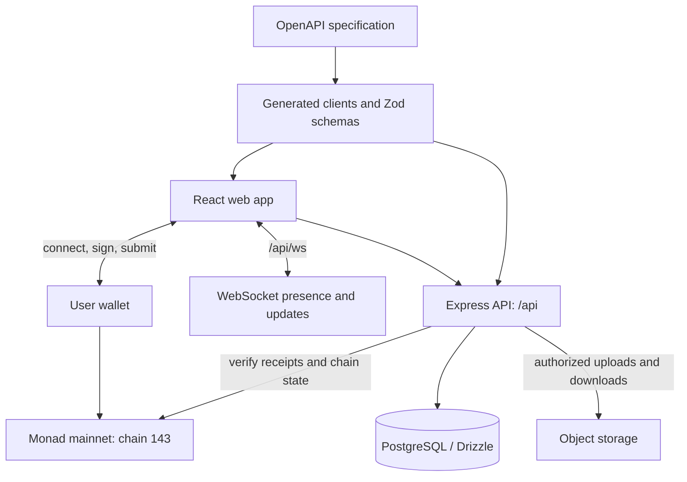

# Architecture

Monad Feet combines a conventional web application with selected Monad
transactions. It is not a fully on-chain social database.

## Package boundaries

| Location | Responsibility |
| --- | --- |
| `artifacts/monad-feet` | React interface, wallet connections, queries and recovery UI |
| `artifacts/api-server` | Authentication, authorization, application rules, receipt checks and realtime endpoints |
| `contracts` | Solidity source and ABI files; source presence alone does not prove a deployed contract matches |
| `lib/db` | Database connection and Drizzle schemas |
| `lib/api-spec` | OpenAPI source and code generation configuration |
| `lib/api-client-react` | Generated client/hooks and shared fetch behavior |
| `lib/api-zod` | Generated validation schemas |
| `lib/object-storage-web` | Upload interface helpers |
| `scripts` | Administrative utilities and isolated test tools |
| `artifacts/mockup-sandbox` | Development component previews, not the production social app |

## What is stored where

- **On chain:** supported registration/action records and publication evidence.
  Receipt validation checks the expected contract, sender, action, and event
  where implemented.
- **PostgreSQL:** application profiles, social content and relationships,
  notifications, messages, subscriptions, and verification/recovery metadata.
- **Object storage:** uploaded media; access is determined by server-side
  content permissions.
- **Browser:** interface state, wallet connection state, and recovery information.
  Browser state alone is not authoritative proof of a chain action or membership.

Text and images are not automatically stored on chain. Points are application
points, not a token balance or claim to money.

## Important trust boundaries

### Wallet connection is not authentication

The wallet interface selects a provider. The API's signed challenge/session
flow establishes identity. Connecting a provider must not grant access to
another member's account or replace signature verification.

### Visibility is enforced on the server

The API protects private data and restricts subscriber content. Hiding a card
or button in React is not an authorization check. Media routes must apply
the same access rules as the post that owns the media.

### Submission is not confirmation

A transaction hash or optimistic interface is not a successful payment or
publication. Server-side receipt validation and the expected chain evidence
are required. Recovery must reconcile existing transactions rather than
inventing evidence or charging again simply because a request was interrupted.

### Shared content is not open membership

A guest-readable shared post/profile does not grant access to private feeds,
messages, subscriber media, or registration without the required admission.

## Developer constraints

- Keep browser API requests same-origin and route `/api` and `/api/ws`
  to the API service.
- Update the OpenAPI specification and generated code together.
- Keep secrets on the server; never put private credentials in `VITE_*` values.
- Keep test identities, mock signatures and intercepted APIs outside the
  production authentication path.
- Use an isolated development database for schema and integration work.

For current operational qualifications, see
[chain status](CHAIN-STATUS.md), [verification](VERIFICATION.md), and the
[reviewer guide](BUILD-WINDOW.md).
